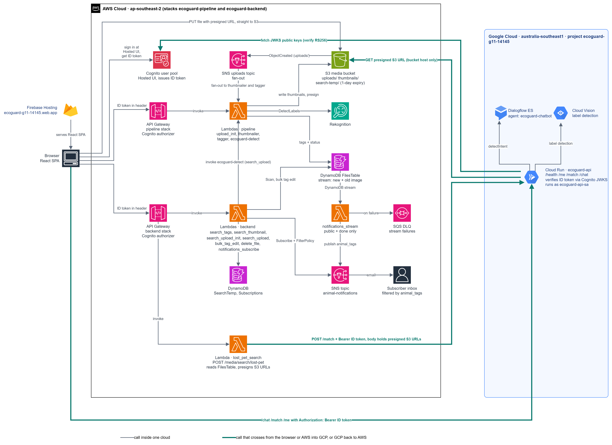

# Aussie EcoGuard

Group 11, FIT3184 Assignment 2. EcoGuard lets people upload photos and videos of pests and pets, tags the animals automatically, and lets them search, edit tags, get email alerts, find lost pets and ask a chatbot. It is serverless and runs on two clouds: **AWS** (storage, pipeline, ML tagging, APIs, user accounts) and **GCP** (Cloud Run API, Cloud Vision, Dialogflow ES, Firebase Hosting).

## Live deployment

| Part | URL / ID |
|---|---|
| Web app (Firebase Hosting) | https://ecoguard-g11-14145.web.app |
| Upload API (AWS, `ecoguard-pipeline`) | https://cz0bx6ka2i.execute-api.ap-southeast-2.amazonaws.com/prod |
| Backend API (AWS, `ecoguard-backend`) | https://sn6wpy8jd9.execute-api.ap-southeast-2.amazonaws.com/prod |
| Cloud Run API (GCP, `ecoguard-api`) | https://ecoguard-api-334103023207.australia-southeast1.run.app |
| Cognito user pool | `ap-southeast-2_WI1ngaH1k`, web app client `ecoguard-web` (`5tv0jne3t88vcrc5408vrtnl6s`) |
| AWS | region `ap-southeast-2` |
| GCP project | `ecoguard-g11-14145`, region `australia-southeast1` |

## Architecture



The PNG embeds the draw.io source: open `docs/architecture/ecoguard-architecture.drawio.png` in draw.io to edit it.

```
Browser (React on Firebase Hosting)
  |-- sign in ---------------------> Cognito (Hosted UI, ID token)
  |-- AWS APIs (token in Authorization) --> API Gateway + Cognito authorizer --> Lambda --> DynamoDB / S3
  |-- /chat, /match (Bearer token) ----------> Cloud Run --> Dialogflow ES / Cloud Vision

Upload:  browser -> POST /upload/init -> presigned PUT -> S3 uploads/
         S3 event -> SNS -> thumbnailer Lambda + tagger Lambda (Rekognition) -> DynamoDB FilesTable
Alerts:  FilesTable stream -> notifications_stream Lambda -> SNS email (failures -> SQS dead-letter queue)
Lost pet: Lambda picks recent public candidates, signs S3 URLs, calls Cloud Run /match with the user's token
```

Cross-cloud links (the two places AWS and GCP meet):

1. **Identity.** Cognito issues the token. Cloud Run verifies it itself against the pool's public JWKS (RS256, checks `iss`, `exp`, `token_use` and the app client ID). No shared secret is stored on either cloud.
2. **Images.** AWS gives Cloud Run short-lived presigned S3 GET URLs. Cloud Run only accepts HTTPS URLs on our bucket host under `search-temp/`, `thumbnails/` or `uploads/`, does not follow redirects, and holds no AWS credentials.

## Repository layout

```
frontend/             React + Vite app, deployed to Firebase Hosting
functions/            AWS pipeline stack: upload init, thumbnails, tagging (Rekognition), detect Lambda
backend/              AWS backend stack: search, bulk tag edit, delete, lost-pet search, notifications
infra/gcp-token-check/  Cloud Run service (FastAPI): Cognito token check, /match, /chat
```

Each folder has its own README with details (`functions/README.md`, `infra/gcp-token-check/README.md`).

## API summary

| API | Route | Purpose |
|---|---|---|
| Upload | `POST /upload/init` | Dedup check and presigned upload URL |
| Backend | `POST /media/search/tags` | Search by tags |
| Backend | `POST /media/search/thumbnail` | Look up a file by its thumbnail |
| Backend | `POST /media/search/upload/init`, `POST /media/search/upload` | Search by uploading an image |
| Backend | `POST /media/search/lost-pet` | Lost-pet matching (calls Cloud Run `/match`) |
| Backend | `POST /media/tags/bulk` | Bulk add or remove tags on your own files |
| Backend | `DELETE /media/{file_id}` | Delete your own file (S3 objects and record) |
| Backend | `POST /notifications/subscribe` | Subscribe an email to animal alerts |
| Cloud Run | `GET /health` (public), `GET /me`, `POST /match`, `POST /chat` | Token check, image matching, chatbot |

**Token headers differ.** AWS API Gateway routes take the Cognito ID token as is: `Authorization: <id_token>`. Cloud Run needs `Authorization: Bearer <id_token>`. Always use the ID token from the web app client `ecoguard-web`; tokens from other app clients are rejected by Cloud Run (`aud` mismatch).

## Deploy

Prerequisites: AWS CLI, SAM CLI, gcloud, Node.js, Firebase CLI. Deploy in this order, because later parts need earlier outputs.

### 1. AWS pipeline (`ecoguard-pipeline`)

```
cd functions
bash layers/build_opencv.sh
sam build
sam deploy --guided      # stack ecoguard-pipeline, region ap-southeast-2
```

Parameters: `BucketName`, `UserPoolArn`, `FrontendOrigin` (default the Firebase site). Details in `functions/README.md`.

### 2. AWS backend (`ecoguard-backend`)

```
cd backend
sam build
sam deploy --guided      # stack ecoguard-backend, region ap-southeast-2
```

Parameters (defaults point at the pipeline stack's table and bucket): `ExistingTableName`, `ExistingBucketName`, `UserPoolArn`, `FrontendOrigin`. After changing `FrontendOrigin`, make sure the API Gateway `prod` stage is redeployed, otherwise CORS keeps the old origin.

### 3. GCP Cloud Run

```
cd infra/gcp-token-check
gcloud config set project ecoguard-g11-14145
gcloud run deploy ecoguard-api --source . --region australia-southeast1 \
  --service-account ecoguard-api-sa@ecoguard-g11-14145.iam.gserviceaccount.com \
  --allow-unauthenticated --min-instances 0 --memory 512Mi --timeout 60 \
  --set-env-vars COGNITO_REGION=ap-southeast-2,COGNITO_USER_POOL_ID=ap-southeast-2_WI1ngaH1k,COGNITO_APP_CLIENT_ID=5tv0jne3t88vcrc5408vrtnl6s,ALLOWED_ORIGINS=http://localhost:5173,https://ecoguard-g11-14145.web.app
```

`--allow-unauthenticated` only skips Google identity checks. Every route except `/health` verifies the Cognito token in code. The service account `ecoguard-api-sa` has only `roles/dialogflow.client`.

### 4. Frontend (Firebase Hosting)

```
cd frontend
npm install
npm run build
firebase deploy --only hosting      # project ecoguard-g11-14145
```

Local development: `npm run dev` (http://localhost:5173). The Cognito app client allows this URL and the hosted site URL as callback and sign-out URLs.

## Security notes

- **Authentication:** Cognito ID tokens. API Gateway uses a Cognito authorizer; Cloud Run verifies the JWT itself.
- **Authorization:** Lambdas take the user from the verified claims (`sub`) and only let a user edit or delete files where `uploaded_by` equals their `sub`.
- **Least privilege:** each Lambda has its own role scoped to the table, S3 prefixes and actions it needs. For example, the delete function can only call `s3:DeleteObject` on `uploads/*` and `thumbnails/*`, and the lost-pet function can only read `uploads/*`, `thumbnails/*` and read/delete `search-temp/*`. Cloud Run has no AWS credentials, and the browser holds no cloud keys.
- **Secrets:** none in the repo. Pool ID, region and client ID are public values. `.env*` files and credential files are git-ignored.
- **Cost control:** two $15 alert-only budgets (AWS and GCP); Cloud Run scales to zero.

## Test guide

### Automated tests

```
# Cloud Run service
cd infra/gcp-token-check
python -m venv .venv && source .venv/bin/activate     # Windows: .venv\Scripts\activate
pip install -r requirements.txt pytest httpx
pytest -q

# AWS backend (all AWS calls are mocked, no credentials needed)
cd backend
python -m venv .venv && source .venv/bin/activate     # Windows: .venv\Scripts\activate
pip install pytest boto3
export AWS_DEFAULT_REGION=ap-southeast-2 TABLE=TestFilesTable BUCKET=test-bucket
pytest -q                                              # PowerShell: $env:AWS_DEFAULT_REGION="ap-southeast-2"; $env:TABLE="TestFilesTable"; $env:BUCKET="test-bucket"
```

Expected: 48 passed for Cloud Run, 69 passed for the backend. The region is needed because some handlers create boto3 clients when imported.

### Get a token

1. Open the web app, sign in with a test user (create one via the Hosted UI sign-up).
2. In the browser console run:
   `Object.keys(sessionStorage).filter(k=>k.startsWith('oidc.user')).map(k=>JSON.parse(sessionStorage[k]).id_token)[0]`
3. Tokens expire after about an hour. Do not commit or share them.

### Manual checks (PowerShell, use `curl.exe`)

```
$T = "<id token>"
$R = "https://ecoguard-api-334103023207.australia-southeast1.run.app"
curl.exe -s "$R/health"                                   # 200, public
curl.exe -s -i "$R/me"                                    # 401, no token
curl.exe -s "$R/me" -H "Authorization: Bearer $T"         # 200, your email

# CORS preflight for DELETE (must list DELETE in access-control-allow-methods)
curl.exe -s -i -X OPTIONS "https://sn6wpy8jd9.execute-api.ap-southeast-2.amazonaws.com/prod/media/test" -H "Origin: https://ecoguard-g11-14145.web.app" -H "Access-Control-Request-Method: DELETE" -H "Access-Control-Request-Headers: authorization,content-type"
```

**Cross-user check.** Upload a file as user A and note its `file_id`. As user B, call `DELETE /media/<file_id>` with B's token (`Authorization: <id_token>`). Expected: 403 and the file still exists. With A's token: 200. With no token: 401.

### Demo flow

Sign in, upload an image, wait for thumbnail and tags, search by tag, edit tags in bulk, ask the chatbot "show me foxes", run a lost-pet search, delete a file, check the notification email.

## Team

| Member | Role | Main areas |
|---|---|---|
| Member 1 (Cullzn) | Infrastructure and auth | AWS and GCP setup, budgets, Cognito, IAM and security review, Cloud Run deployment, cross-cloud auth, architecture diagram |
| Member 2 (Josh) | Pipeline and ML | Upload pipeline, thumbnails, Rekognition tagging (`functions/`) |
| Member 3 (Sarah) | Backend APIs | DynamoDB access, search, bulk tag edit, delete, lost-pet search, notifications (`backend/`) |
| Member 4 (Chay Hong) | Frontend and chatbot | React app, Firebase Hosting, Dialogflow ES |

## Clean-up after assessment

Delete the `ecoguard-pipeline` and `ecoguard-backend` stacks (empty the S3 bucket first), the Cloud Run service `ecoguard-api`, the Firebase site, and the leftover `ecoguard-cli-test` Cognito app clients and test users.
